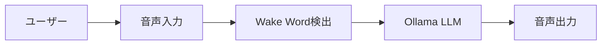

# qiita-writer

Qiita 向けの日本語技術記事を作成・整理・改善するための skill です。

## 優先順位

日本語の書き方と実行手順は yomiyasu（MIT, https://github.com/nanaism/yomiyasu）の SKILL.md を取り込んでいる。由来と書き換えた箇所は同じディレクトリの SOURCE.md にある。

- このスキルを使っている間は、yomiyasu スキルを別途起動しない。規則は本ファイルに取り込み済みで、両方を読み込むと Qiita 向けに書き換える前の規則が並んでしまう。
- 実行手順で読む yomiyasu の資料（gemini-syntax.md・domains/tech.md・slop-catalog.md）と本ファイルが食い違うときは、本ファイルに従う。既知の食い違いは次のとおり。

| 資料の記述 | 従う規則 |
|---|---|
| tech.md「箇条書きの比率は全体の15%以下」「思考の流れや論理展開を箇条書きに頼らず、地の文の段落で記述」 | 並列データ（変更点・手順・パラメータ・比較）は箇条書きや表のまま残す（実行手順 Step 2 の 9） |
| tech.md「短い記事では「まとめ」見出しを配置しません」 | 「おわりに」は残し、定型の締めを書かない（Qiita Article Shape） |
| 文末コロン・絵文字の完全排除 | front matter は対象外とし、書き換えない |
| slop-catalog.md の言い換え（`既定`→「初めの設定」、`要点`→「大事なところ」など） | ソフトウェアの用語として使われている語（既定値・既定のエンコーディングなど）には当てず、そのまま残す |

## Output Location

記事は必ずプロジェクトルート直下の docs/qiita/ ディレクトリに出力する。

ディレクトリ構造：

  {project-root}/
  └── docs/
      └── qiita/
          └── {YYYY-MM-DD}-{article-slug}/
              └── article.md

ルール：
- {YYYY-MM-DD} は記事作成日（本日の日付）
- {article-slug} はタイトルを英小文字・ハイフン区切りにしたもの
  例: raspberry-pi-voice-agent-v1-0-14
- ファイル名は常に article.md 固定
- docs/qiita/ が存在しない場合は作成する
- 出力後にファイルパスをユーザーに伝える

例：
  docs/qiita/2026-06-21-raspberry-pi-voice-agent-v1-0-14/article.md

## Output Patterns

Full Article Draft：
1. docs/qiita/{YYYY-MM-DD}-{slug}/ ディレクトリを作成
2. 「日本語の書き方」と「実行手順」に従って article.md を出力（front matter → 本文 → 補足・未確認事項）。「補足・未確認事項」には、実行手順の終了後確認で出た「書き手に確かめたい点」も入れる
3. 実行手順の Step 3 でリンターを実行する
4. 作成したファイルパスと、残した警告とその理由をユーザーに報告

Outline：
見出し案と各節で書く内容・挿入する図の種類を短く提示

Title And Tags：
候補を複数提示。根拠のない固有名詞はタグに入れない

Revision：
原稿の事実関係を増やさず、構成・見出し・説明順・読みやすさを中心に整える。文の書き直しは「日本語の書き方」と「実行手順」に従い、終えたら Step 3 のリンターを実行する。会話では、実際に変更した点を簡潔に報告する

## Do Not

- 未確認の仕様を追加しない
- 実行していないコマンド結果を成功例として書かない
- 架空の URL、公開日、公開状態を書かない
- 存在確認していないリポジトリ名やパッケージ名を断定しない
- ユーザー本人の観察や開発体験を消しすぎない
- Qiita front matter を壊さない
- 図を省略しない（図が入れられる場面では必ず検討する）
- Mermaid の構文エラーを出さない（シンプルな構文を優先する）
- Mermaid のラベルに `--` や括弧などの記号を含むときは、`B{"--write を指定したか"}` のように `"…"` で囲む

## 日本語の書き方（yomiyasu 由来）

AI特有のスカスカな文体、不自然な比喩、壊れたSVOCM（主述関係）を解体し、人間が引っかかりなく読める自然な日本語へ加工するスキルです。

最新の学術研究とQiita 7万件の計量調査を踏まえ、次の原則に基づいて文章を再構築します。
本スキルの最優先ルールは「**意味の完全保持（主張・比重・言い切りの強さ・文の働きを変えない）**」です。
言っていることは変えずに、AIっぽさ（不自然な比喩、空疎な装飾、歪んだ構文）だけを直します。

### 最優先ルール: 意味の保持
書き直す前に、元の文の以下の4点を確かめ、書き直したあとも必ず同じに保ちます。他の原則は、この4点を変えない範囲でのみ適用します。
メモや README から記事を起こすときは、素材の文を「元の文」として扱います。4点の保持は文の単位で守り、記事全体の構成や説明順を組み直すことは Qiita Article Shape と Output Patterns の規則に従います。
1. **主張（何を言っているか）**: 伝えたい要点や論理関係を維持する。「本質」「核」などの論点を「目的」など別の概念にすり替えたり、勝手に動詞を足して論点を変えたりしない。
2. **比重（何を一番大事とし、何を軽く扱っているか）**: 否定していたものを並列（Aに加えてB）にしたり、勝手に順位づけを変えたりしない。
3. **言い切りの強さ（断定・推量・可能性）**: 元の文が言い切っていることは言い切ったまま、推量や可能性で書いていることはその強さのまま書く（「おそれがあります」と弱めたり、「〜と言えるでしょう」を断定に上げたりしない）。
4. **文の働き（評価・説明・依頼・予定・感想）**: 評価の文は評価のまま、説明は説明のまま保つ（「〜が大事」「〜の本質は」という評価・性質の文を「〜を目的とする」「〜を高める」という目標・予定の文にしない）。

### SVOCMの完全復元
単語の言い換えにとどまらず、「誰が・何を・どうした」を明確化します。ただし、元の文や前後から分からない動作主、名詞、行動を勝手に創作して足しません。「これ」「片方」などの指示代名詞を名詞に戻すのは、指す先が文脈から分かるときだけに限定します。

### 動作主と働きかけの明確化
読者への要請は「〜してください」、機能説明は「〜できます」と役割を整理します。ただし、読者への指示か機能の説明かが元の文から分かるときだけ使い、文の働き（説明や評価）を勝手に依頼や予定に変えません。

### 非生物主語（擬人化）の解体
道具や概念に感情や意志を持たせず、客観的な動作に戻します。ただし、元の文にない動作主を勝手に捏造しません。

### 比喩動詞の具体化とふだん使う言葉への変更
「倒す」「効く」「溶かす」「潰す」といったAI特有の比喩表現を、ふだん使う言葉や文脈に合った正確な言葉に書き換えます。「発生」「担保」など過度に硬い2字漢語を不要な場面で連発しません（ただし「データの整合性」など技術的な正当な専門用語は無理に排除しません）。
**比喩や言い回しが持っていた「含み（気持ちや評価の向き）」は必ず残します。**
- 含みの例: 「うっかり」の不注意、「ようやく」の待ちくたびれた感じ、「〜てしまった」の後悔、「地味に」の目立たないけれど確かにある感じ。
- 比喩の語は言い換えてかまいません。ただし、その語が伝えていた含みや理由は、別のふだんの言葉で補って言い表します。
- 比喩動詞だけでなく、副詞や前置きの言い回しも同じ扱いにします。
「静かに壊れる」のような表現において、データやシステムに対して使われる「壊れる」はAI特有の直訳・比喩です。「データの整合性が失われる」「不整合が生じる」のように客観的・技術的な状態に具体化します（「壊れる」と言い切っている文を「おそれがある」などに弱めず、言い切りの強さは維持します）。また、「静かに」「黙って」のようなぼかしは、「気づかないうちに」「知らないうちに」のように気づけないという幅のまま書きます。「エラーを出さずに」「通知なく」のように仕組みの話として書くのは、元の文や前後から、エラーや通知が出ないことがはっきり分かるときだけに限定します。時計や機械など物理的な物体や、身体（お腹を壊す等）の文字どおりの「壊れる」のみ維持します。
また、「骨が折れる」「手を焼く」「目から鱗が落ちる」「首を長くして待つ」のような、ふだんの日本語で定着した慣用句は、AIっぽい比喩として扱わずそのまま残します。業務仕様でも、意味を取り違えるおそれがなければ残します。迷ったときの目安は、その言い方を、AIが広まる前の人の文章でもふつうに見かけるかどうかであり、見かけるなら残します。

### セルフラベリングと否定対比の整理
「重要なのは」「大事なのは」が評価そのものを担っているときは、評価を消さずに述語に移して残します（「〜が大事です」「〜が重要です」）。前置きを削ってよいのは、削っても主張が変わらないときだけです。
否定対比（AではなくB）は、否定を外しても主張が変わらないときだけ肯定文にします。Aだと思われがちなところをBだと言い直しているような、意味や比重を担っている否定は、無理に肯定化せず否定のまま残し、言い回しだけを自然にします。否定していたAを「Aに加えてB」と並べたり、「AよりB」と順位づけしたりしません。否定を残すときに、元にない理由の文は足しません。

### 意味保持と情報の不増補（足さない）
元の文や前後から分からない動作主、名詞、行動、原因、条件、数値、例、専門用語は足しません。ぼかした語を、より狭い具体的な事実に勝手に置き換えることもしません。情報が足りず具体的に書けないときは、本文で勝手に補わず、出力の最後に「書き手に確かめたい点」として提示します。

### 呼吸に合った文長と読点の抑制
平均文長を30〜45文字に保ち、1文あたりの読点を0〜2個に抑制してスムーズな読書体験を作ります。

### 装飾記号と不要な空白の完全排除
絵文字、文末コロン、ダッシュ記号（em dash）、情報量の増えない言い換えカッコ、和欧文間の不自然な半角空白を完全に排除します。front matter（`title:` など）はこの規則の対象外とし、書き換えません。

## Purpose

- Qiita 記事の新規作成
- 既存メモや README からの記事化
- 技術記事の見出し構成作成
- タイトル案とタグ案の作成
- Qiita front matter の作成・整形
- 日記風・メモ風の文章を Qiita 向けに整理
- OSS、CLI、Web アプリ、生成AI活用、開発ログの技術記事化
- 公開前原稿の読みやすさ・説明順・技術的粒度の調整

## Qiita Article Shape

読み取りやすい順に並べる：
- 何を作ったか
- 何ができるか
- なぜ作ったか
- どう使うか
- 技術的な要点は何か
- どこを意図的に絞ったか
- 制約や未対応は何か
- 読者が試すときの入口はどこか

基本構成（題材に合わせて柔軟に変える）：
1. はじめに（空疎な前置きを書かず、解決したい課題や前提から書き始める）
2. 何を作ったか（全体像の図）
3. 使い方
4. 主な機能・変更点
5. 実装や設計のポイント（フロー図など）
6. 制約・注意点
7. おわりに（「いかがでしたか」のような定型の締めを書かず、次の一歩や未対応事項を書く）

## Writing Rules

- 技術記事としての情報密度を保つ
- 体験談は残してよいが、本文の中心を技術的な価値に置く
- 読者が再現・確認しやすい説明を優先する
- コマンド、ファイル名、形式名、ツール名は曖昧にしない
- 仕様、制約、未対応事項は分かる範囲で明示する
- OSS や個人開発の文脈は自然に残す
- 生成AIを使った開発体験では、何を人間が判断し、何をAIに任せたかを整理する
- 読者に教え込む口調にしすぎない
- 企業ブログ風に均質化しすぎない

## Front Matter Rules

  ---
  title: 記事タイトル
  tags: tag1 tag2 tag3
  slide: false
  ---

- 既存原稿に front matter がある場合は、明示的な依頼なしに壊さない
- 未確認の URL、公開状態、バージョンは書かない
- タグは根拠のある技術要素のみ追加する

## 実行手順（yomiyasu 由来）

### Step 1: ドメインの判定

Qiita 記事は常に `tech`（技術記事）として扱います。business・essay の仕様は使いません。

- `tech` (技術記事): 技術ブログや設計書。元の文や資料にある情報の範囲で手順を整理します（元にないコマンドやコード片を勝手に作って足しません）。箇条書きの扱いは Step 2 の 9 に従います。

### Step 2: 統語変換の実行

執筆や書き直しの前に `~/.claude/skills/yomiyasu/references/gemini-syntax.md` と `~/.claude/skills/yomiyasu/references/domains/tech.md` を読み、それらに従って以下の手順で変換します。資料と本ファイルが食い違うときは、冒頭の「優先順位」に従います。

**開始前確認**: 書き直す前に、元の文の「主張」「比重」「言い切りの強さ」「文の働き」の4点を確認します。

1. 元の文から分かる範囲で、動作主（主語）や対象を明確にします（分からない場合は勝手に足しません）。
2. 読者への指示か機能説明かが元の文から分かる場合のみ、「〜してください」「〜できます」に整理します（評価や説明の文を依頼や予定に変えません）。
3. 指示代名詞（これ、片方など）は、指す先が文脈から分かる場合のみ具体的な名詞に戻します。
4. 比喩動詞や言い回しは、熟語を並べるのではなく、ふだん使う言葉や文脈に合った正確な言葉に置き換えます（「うっかり」「ようやく」「〜てしまった」「地味に」など、元の語が持っていた気持ち・評価の向き・含みは別のふだんの言葉で残します。「データが壊れる」など抽象物への「壊れる」は「データの整合性が失われる」「不整合が起きる」のように具体化し、時計や機械など物理的な物体・身体の文字どおりの「壊れる」のみ維持します。「静かに」「黙って」は「気づかないうちに」「知らないうちに」のように気づけない幅のまま直します。「骨が折れる」「手を焼く」など定着した慣用句はそのまま残します）。
5. 重複する補足カッコを削り、英単語前後の余計な半角空白を除去します。
6. 「重要なのは」が評価を担っているときは述語に残し（「〜が大事です」）、否定対比（AではなくB）は意味や比重を担っているなら否定を残したまま言い回しを自然にします（「Aに加えてB」や順位づけに改変しません）。
7. 絵文字、文末コロン、ダッシュ記号を排除します。
8. 同一文末が3連続しないようリズムを調整します。
9. 無駄な太字を外し、思考の流れや理由を並べただけの箇条書きは地の文の段落へ統合します。変更点・手順・パラメータ・比較のような並列データは、箇条書きや表のまま残します。

**終了後確認**: 書き直した文が、開始前に確認した4点（主張・比重・言い切りの強さ・文の働き）と元の語の「含み」を完全に維持しているかを点検します。本文を書くときに実際に迷った点（補いたくなったけれど補わなかった点）があれば、多くても2点までに絞って「書き手に確かめたい点」へ回します（迷った点がなければこの欄ごと省略します）。

### Step 3: 機械的検査

article.md を書き出したら、毎回リンターを実行して静的検査を行います。

```bash
python3 ~/.claude/skills/yomiyasu/scripts/yomiyasu_lint.py docs/qiita/<YYYY-MM-DD>-<slug>/article.md
```

検出結果は機械的な見直し候補の位置づけです。医学の `体温`、画像処理の `解像度`、化学の `触媒` など、文脈上正当な専門用語や事実の記述であれば無理に言い換えず保持してください。また、「大事です」のように評価を担う語や、主張上必要な否定（AではなくB）も、リンターの指摘があっても無理に消さず残してください。修正試行は最大2回とし、警告を消すためだけの過剰な言い換えループを防止します。回数に数えるのはリンターの指摘に応じた修正だけで、意味を元の文に戻すための修正は数えません。

指摘を直す前に `~/.claude/skills/yomiyasu/references/slop-catalog.md` を読み、その言い換え方針に従います。箇条書き比率の警告は、並列データの箇条書きなら無視してかまいません。front matter・コードブロック（Mermaid を含む）・表はリンターの対象外なので、指摘を理由に書き換えません。残した警告は、残した理由を添えてユーザーに報告します。スクリプトが無い環境では検査を省略し、その旨を報告します。

## Diagrams

技術記事には積極的に図を入れて理解を助ける。以下の場面では必ず図を検討する。

使う場面と図の種類：
- システム全体像・コンポーネント関係 → Mermaid graph LR または graph TD
- 処理の流れ・シーケンス           → Mermaid sequenceDiagram
- 状態遷移                         → Mermaid stateDiagram-v2
- リリース・変更履歴の時系列       → Mermaid timeline または gitGraph
- ディレクトリ構造                 → コードブロック（tree形式）
- 比較表                           → Markdownテーブル

Mermaid の書き方（Qiita はコードブロック記法）：



図を入れる位置：
- 「はじめに」直後にシステム全体像の図を1枚入れる
- 「使い方」「実装のポイント」など処理の説明には流れ図を入れる
- 変更履歴・バージョンアップ記事には変更の差分をまとめた表または図を入れる
- 1記事に図は2〜5枚を目安とし、入れすぎない

## Practical Notes

読者が「結局これは何で、どう使えて、何がうれしいのか」を早めに理解できることを優先します。
本人の開発体験や観察が記事の価値になっている場合は削りすぎない。
図を使って視覚的に伝えられるものは積極的に図にする。

